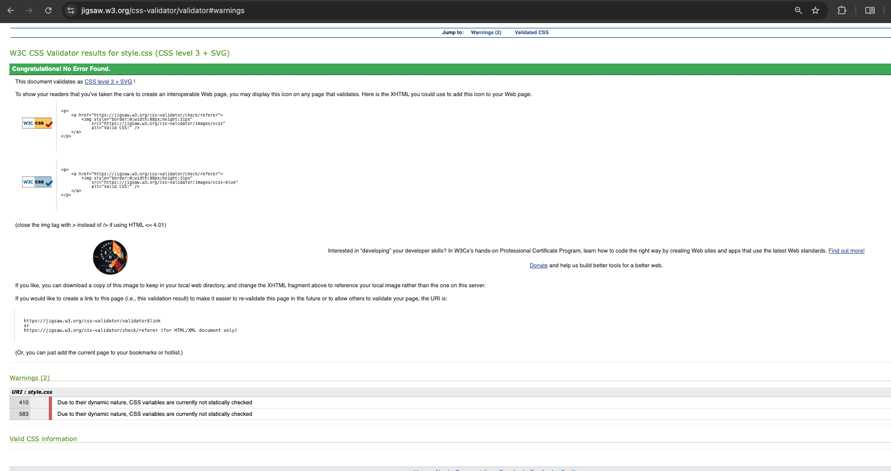
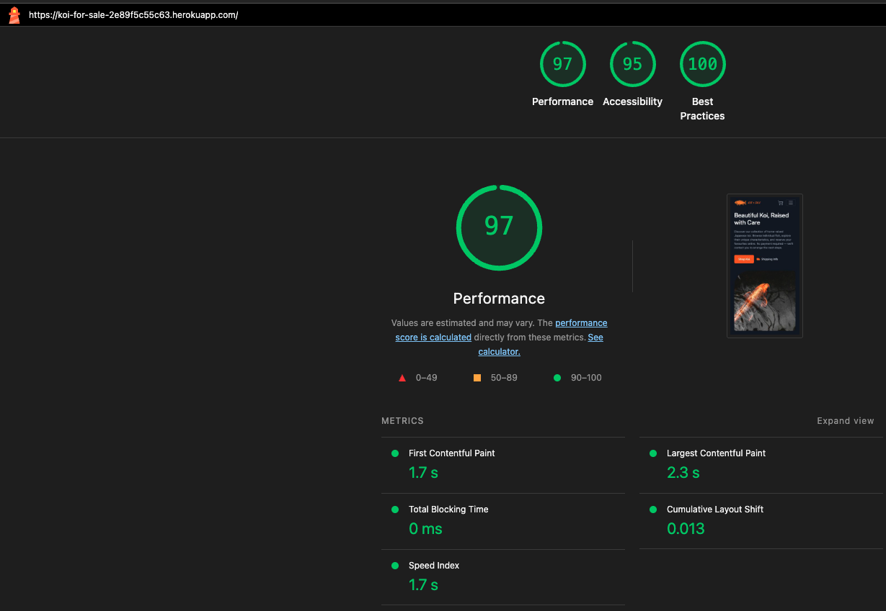
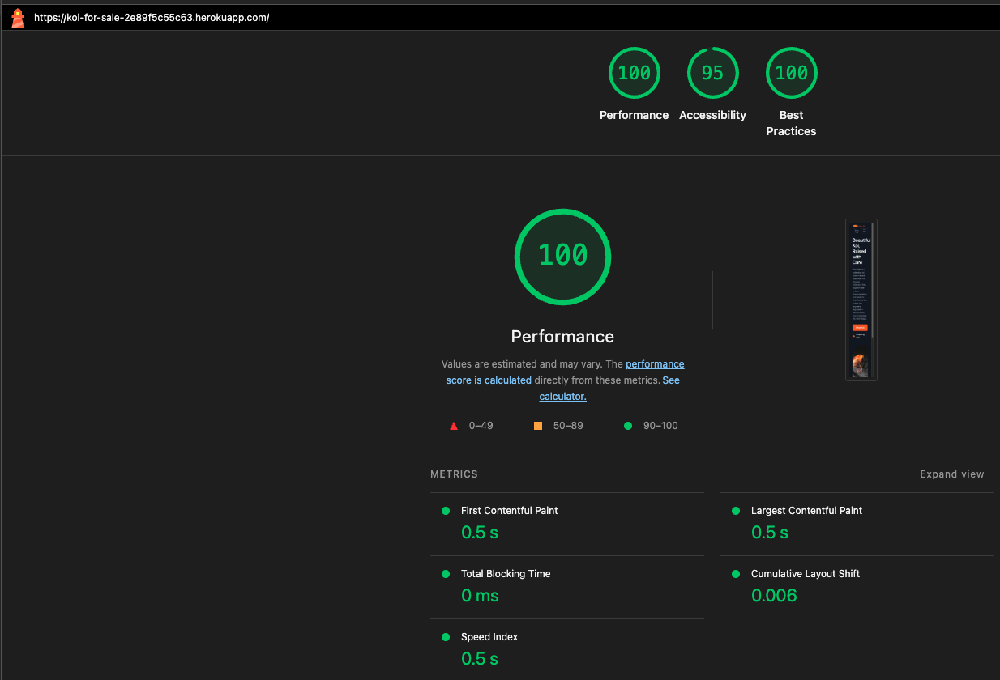
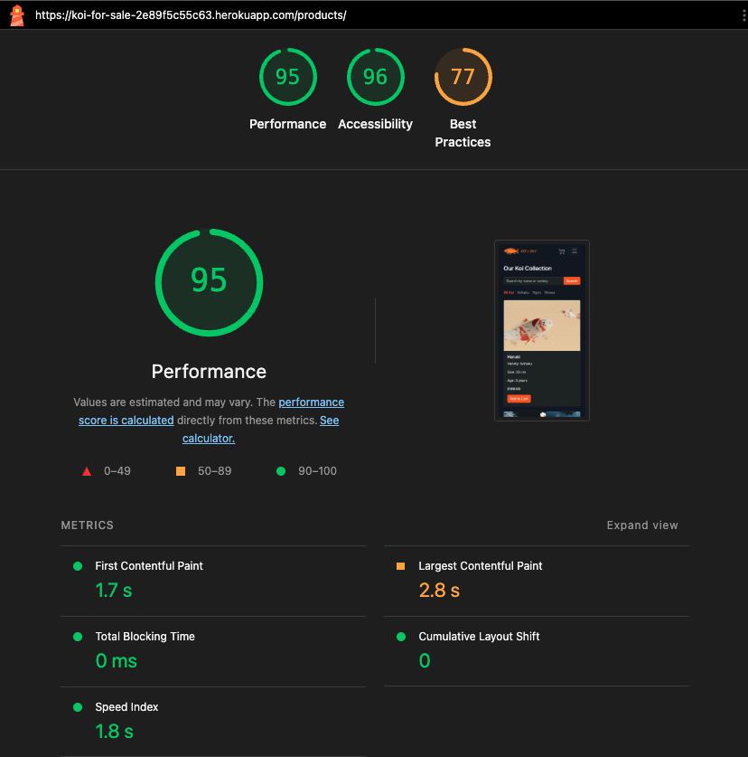
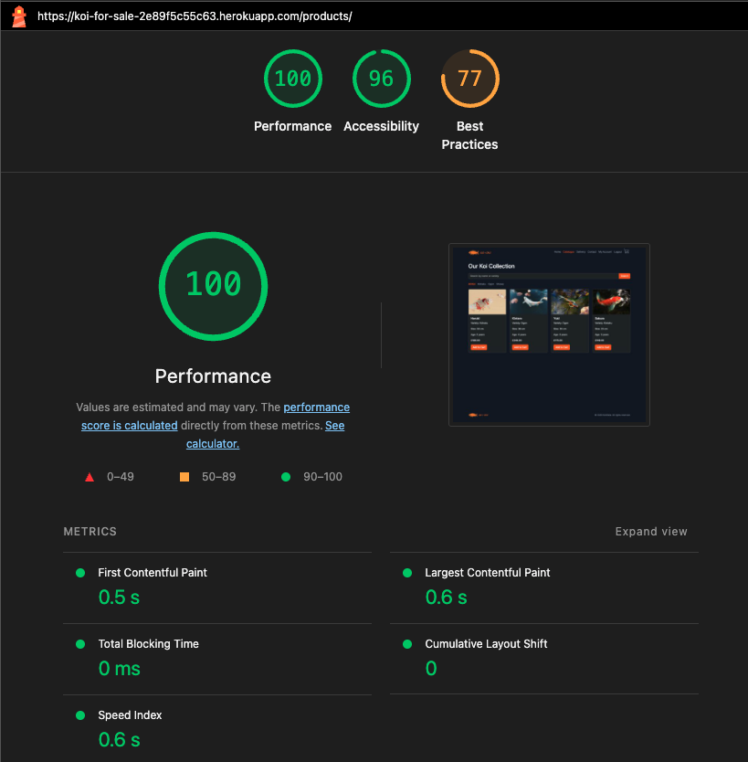
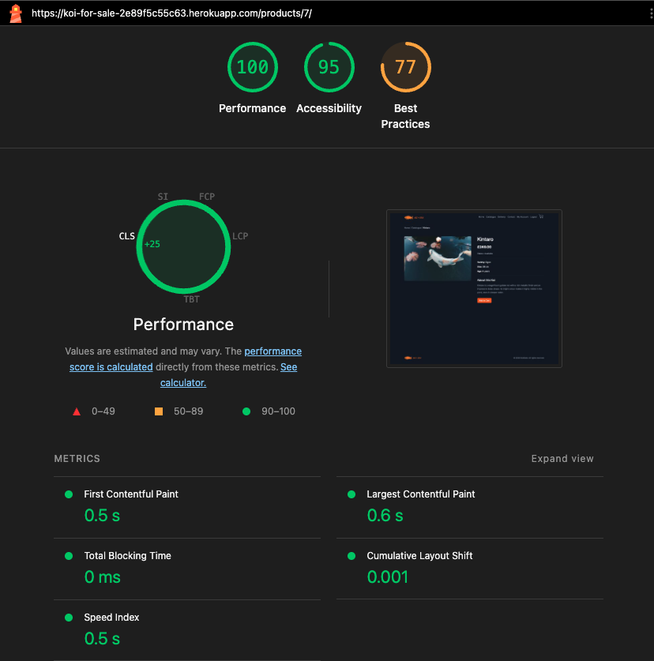

# Koi4Sale — Testing

## Overview

This document records the final quality assurance results for Koi4Sale, covering automated tests, code validation, manual functionality, responsive behaviour, browser compatibility, accessibility and deployment verification. Results reflect checks completed by 2 November 2026. Known limitations and Lighthouse findings are documented without claiming that every possible browser state or accessibility criterion was audited.

## Automated Testing

### Django Test Suite

Testing framework: [Django testing tools](https://docs.djangoproject.com/en/5.2/topics/testing/).

Run from the project root:

```bash
python3 manage.py test
```

| Check | Result |
| --- | --- |
| Django automated tests | **PASS — 125 tests** |
| Django system checks during test run | **PASS — no issues reported** |

The suite covers products, reservations, account functionality and related application behaviour. Individual cases are documented in the project's test modules.

### JavaScript Tests (Jest)

Testing framework: [Jest](https://jestjs.io/).

```bash
npm test
```

**Result: PASS — 3 test suites and 27 tests passed; 0 failures.**

**Combined automated testing: 152/152 tests passed.**

## Code Validation

### Python — PEP 8

Validation tool: [pycodestyle](https://pycodestyle.pycqa.org/).

```bash
pycodestyle . --exclude=.venv,migrations,staticfiles,node_modules,env.py --max-line-length=79
```

**Result: PASS — no violations reported.**

### HTML — W3C Nu HTML Checker

Validation service: [Nu HTML Checker](https://validator.w3.org/nu/).

Rendered pages were checked against the HTML standard on 2 November 2026.

| Page / state | Result |
| --- | --- |
| Home | PASS |
| Product catalogue | PASS |
| Product details | PASS |
| Shopping cart | PASS |
| Reservation confirmation | PASS |
| Delivery information | PASS |
| Contact | PASS |
| Sign up | PASS |
| Login | PASS |
| User profile | PASS |
| Edit profile | PASS |
| Delete account confirmation | PASS |
| Custom 404 page | PASS |

**Result: PASS — no HTML validation errors reported for the checked pages.** This does not imply that every possible form-error or dynamic state was separately checked.

### JavaScript — Static Analysis

The `static/js/cart.js` file was checked using [JSHint](https://jshint.com/). **Result: PASS — 0 errors.** Four compatibility warnings were reported because of the selected ECMAScript version settings. No undefined variables were reported.

### CSS — W3C CSS Validator

The current `style.css` was validated using the [W3C CSS Validation Service](https://jigsaw.w3.org/css-validator/) (CSS Level 3 + SVG).

| Check | Result |
| --- | --- |
| Errors | **0** |
| Warnings | **2** |
| Overall | **PASS** |

The two warnings, at lines 410 and 583, state that CSS custom properties cannot be fully checked statically because their values are dynamic. No CSS changes were required. CSS validation checks stylesheet syntax; it does not establish accessibility or colour-contrast compliance.



### Static Assets

**Status: PASS — collection completed and deployed assets manually verified.**

Django's static-file collection command completed successfully:

```bash
python3 manage.py collectstatic
```

| Collection output | Count |
| --- | ---: |
| Files copied | 2 |
| Files unchanged | 149 |
| Files post-processed | 395 |

The successful collection confirms that Django's static-file pipeline completed. Separately, manual verification confirmed that pages, images and frontend functionality load and work on the deployed Heroku application. This is a functional deployment check, not an exhaustive audit of every unused asset in the repository.

## Manual Functional Testing

**Status: PASS.** Manual testing confirmed that the main application workflows operate correctly. Individual scenario results are recorded below.

| Area | Scenario | Result |
| --- | --- | --- |
| Catalogue | Browse, search and filter available koi | PASS |
| Product details | View information and product images | PASS |
| Cart | Add, remove and persist products; verify totals | PASS |
| Reservation | Validate form and submit a reservation | PASS |
| Reservation security | Verify UUID-based confirmation links and HTTP 404 responses for invalid tokens | PASS |
| Authentication | Register, log in and log out | PASS |
| Account | View, edit and delete account | PASS |
| Permissions | Restrict access to authenticated pages | PASS |
| Administration | Manage products, images and orders | PASS |
| Navigation | Verify links, menus and custom 404 page | PASS |

## Responsive Testing

**Status: PASS.** Responsive behaviour was manually checked at the following viewport widths:

| Viewport | Width | Result |
| --- | --- | --- |
| Mobile | 375 px | PASS |
| Tablet | 768 px | PASS |
| Desktop | 1440 px | PASS |

Manual testing confirmed that the reviewed layouts display correctly at all three widths. No responsive defects were reported.

## Browser Compatibility

**Status: PASS.** The release was manually checked in Google Chrome, Safari and Mozilla Firefox at three viewport widths. All nine browser/viewport combinations were reported as working correctly.

| Browser | Version | 375 px (Mobile) | 768 px (Tablet) | 1440 px (Desktop) |
| --- | --- | --- | --- | --- |
| Google Chrome | 155.0.8059.86 (arm64) | PASS | PASS | PASS |
| Safari | 26.6.2 (21624.5.1.11.3) | PASS | PASS | PASS |
| Mozilla Firefox | 159.0 (aarch64) | PASS | PASS | PASS |

## Accessibility Testing

**Status: PASS for the checks listed below.** Keyboard navigation and visible focus were manually verified. Form labels, image alternative text and heading structure were reviewed in the available project templates. These checks do not constitute a comprehensive accessibility audit.

| Check | Method | Result |
| --- | --- | --- |
| Keyboard navigation (Tab / Shift + Tab) | Manual browser testing | PASS |
| Visible keyboard focus | Manual browser testing | PASS |
| Form labels | Template review | PASS |
| Image alternative text | Template review | PASS |
| Heading structure | Template review | PASS |

A separate manual colour-contrast assessment was **not included in the scope of this review**; no claim of contrast compliance is made. Lighthouse's contrast finding is documented below.

## Lighthouse Testing

**Status: COMPLETED — findings documented.** The deployed application was audited on 2 November 2026 using [Google Lighthouse](https://developer.chrome.com/docs/lighthouse/overview/). Mobile and desktop results were recorded for three representative pages. **SEO was excluded from the testing scope.** Scores are snapshots and may vary between runs.

| Page | Device | Performance | Accessibility | Best Practices |
| --- | --- | ---: | ---: | ---: |
| Home | Mobile | **97** | **95** | **100** |
| Home | Desktop | **100** | **95** | **100** |
| Catalogue | Mobile | **95** | **96** | **77** |
| Catalogue | Desktop | **100** | **96** | **77** |
| Product details | Mobile | **98** | **95** | **77** |
| Product details | Desktop | **100** | **95** | **77** |

### Performance Metrics

| Page | Device | FCP | LCP | TBT | CLS | Speed Index |
| --- | --- | ---: | ---: | ---: | ---: | ---: |
| Home | Mobile | 1.7 s | 2.3 s | 0 ms | 0.013 | 1.7 s |
| Home | Desktop | 0.5 s | 0.5 s | 0 ms | 0.006 | 0.5 s |
| Catalogue | Mobile | 1.7 s | 2.8 s | 0 ms | 0 | 1.8 s |
| Catalogue | Desktop | 0.5 s | 0.6 s | 0 ms | 0 | 0.6 s |
| Product details | Mobile | 1.7 s | 2.1 s | 0 ms | 0.013 | 1.7 s |
| Product details | Desktop | 0.5 s | 0.6 s | 0 ms | 0.001 | 0.5 s |

### Findings

- **Best Practices:** Catalogue and product detail pages scored 77. The catalogue audit identified third-party cookies and cookie-related DevTools issues associated with images served from Cloudinary. These findings are documented; the score does not by itself establish a security vulnerability. The detailed cause of the product page score was not independently verified.
- **Accessibility:** Lighthouse reported insufficient foreground/background contrast on the catalogue page. A separate manual colour-contrast assessment was excluded from this review; therefore, colour-contrast compliance is not claimed.
- **Performance:** Catalogue diagnostics identified render-blocking resources, an LCP image using lazy loading, images without explicit dimensions, and potentially unused CSS/JavaScript. These are optimisation opportunities, not failed functional tests.

### Evidence

The six screenshots below show the recorded scores and key metrics.

| Page | Mobile evidence | Desktop evidence |
| --- | --- | --- |
| Home |  |  |
| Catalogue |  |  |
| Product details |  |  |

## Static Files and Deployment

**Status: PASS — deployed application manually verified.**

After the latest deployment to Heroku, manual verification confirmed that the live site and its principal workflows were working correctly.

| Production check | Result |
| --- | --- |
| Main pages and navigation | PASS |
| CSS, JavaScript and images display correctly | PASS |
| Registration, login and account management | PASS |
| Shopping cart interactions | PASS |
| Reservation submission | PASS |
| Reservation confirmation page | PASS |

Static-file collection completed successfully (see [Static Assets](#static-assets)). These checks confirm the tested production journeys; they do not imply exhaustive verification of every possible server or network failure.

## Bugs Identified and Resolved

The following defects were identified and resolved during development. Their corresponding GitHub Issues and automated regression coverage provide implementation and verification history.

| Issue | Defect | Resolution and verification |
| --- | --- | --- |
| Cart button reload bug (issue number unverified) | Cart button returned to its default state after a page reload even when the product remained in `localStorage`. | Restored button state from stored cart data during initialisation; Jest regression test passed. |
| #26 | Saving a product in Django Admin could affect its selected primary image. | Corrected primary-image selection handling and verified the fix. |
| #27 | Malformed or nonexistent category/cart product IDs could trigger unhandled errors. | Added controlled validation and error responses; Django regression tests passed. |
| #42 | Deleting reservations could leave associated koi marked as reserved. | Added order-deletion handling, including bulk deletion, to release affected products; tests passed. |
| #43 | Cart product-fetch failures were not handled clearly. | Added an error state and Retry action while preserving cart data; JavaScript tests passed. |

No unresolved functional defects were reported in the final manual verification. The Lighthouse findings and validator warnings listed above remain documented limitations rather than being presented as resolved bugs.

## Testing Summary

| Area | Status |
| --- | --- |
| Django automated tests | PASS — 125 tests |
| Python PEP 8 | PASS |
| HTML validation | PASS — checked pages |
| JavaScript automated tests | PASS — 27 tests |
| JavaScript static analysis | PASS — 0 errors, 4 ES8 configuration warnings |
| CSS validation | PASS — 0 errors, 2 CSS custom-property warnings |
| Manual functional testing | PASS |
| Responsive testing | PASS — 375 px, 768 px, 1440 px |
| Browser compatibility | PASS — Chrome, Safari and Firefox at 3 viewport widths |
| Accessibility testing | PASS — documented checks only; contrast not independently verified |
| Lighthouse | COMPLETED — 6 audits; findings documented |
| Static asset collection | PASS |
| Production deployment verification | PASS — confirmed on Heroku |

**Overall status: COMPLETED.** The documented automated tests, validation checks and manual production verification are complete. Known Lighthouse findings, validation warnings and the limits of accessibility coverage are recorded above.
