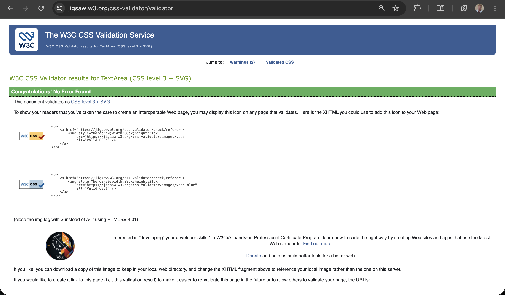
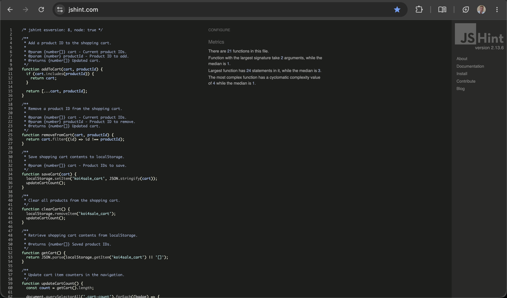
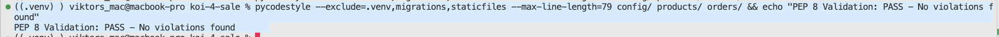

# Koi4Sale – Testing

## Overview

Koi4Sale was tested using Django's built-in test framework, Jest and manual checks. Automated tests verify application logic, while manual checks assess user-facing behaviour and administration.

Testing covers product management, reservations, authentication, account management, shopping cart functionality, responsive design, accessibility and browser compatibility.

The results below distinguish completed checks from those still awaiting verification.

## Automated Testing

### Django

Run the complete Django test suite:

```bash
python3 manage.py test
```

Latest result:

```text
Found 115 test(s).
Creating test database for alias 'default'...
System check identified no issues (0 silenced).
----------------------------------------------------------------------
Ran 115 tests in 53.854s

OK
Destroying test database for alias 'default'...
```

Django tests cover:

- Product catalogue, search and category filtering.
- Invalid category and product IDs.
- Product details and image handling.
- Reservation form validation.
- Reservation creation and confirmation.
- Prevention of duplicate reservations.
- Order cancellation and product availability.
- Customer registration and authentication.
- Login and logout functionality.
- Customer profile management.
- Account deletion and access permissions.
- Password hashing and security.
- Crispy Forms integration with Bootstrap 5.
- Reservation confirmation access using UUID tokens.

**Result: PASS — 115 tests passed.**

### JavaScript

Install dependencies and run Jest:

```bash
npm install
npm test
```

Latest result:

```text
PASS tests/cart-ui.test.js
PASS tests/cart-page.test.js
PASS tests/cart.test.js

Test Suites: 3 passed, 3 total
Tests:       23 passed, 23 total
Snapshots:   0 total
Time:        0.428 s
Ran all test suites.
```

JavaScript tests cover:

- Adding products to the shopping cart.
- Removing products from the shopping cart.
- Preventing duplicate cart entries.
- Persisting cart contents in localStorage.
- Restoring cart button states after page reload.
- Updating the shopping cart indicator.
- Calculating and displaying the cart total.
- Rendering shopping cart products.
- Adding product IDs to reservation requests.
- Handling empty shopping carts.

**Result: PASS — 23 tests passed.**

### Results

| Test suite | Passed | Failed | Result |
| ---------- | -----: | -----: | ------ |
| Django     |    115 |      0 | PASS   |
| Jest       |     23 |      0 | PASS   |
| **Total**  | **138** |  **0** | **PASS** |

## User Story Testing

The table summarises verification of the implemented user stories.

Automated results are supported by the passing test suites above. Screenshots of implemented features are provided in the main README's Features section.

| User Story | Verification | Result |
| ---------- | ------------ | ------ |
| Browse Available Koi | Check catalogue displays available products and excludes reserved products. | PASS |
| View Koi Details | Check product information, images and add-to-cart action. | PASS |
| Filter Koi by Category | Check category filtering and matching results. | PASS |
| Search Koi | Check search functionality by name and variety. | PASS |
| Responsive Catalogue | Check product grid and images on mobile, tablet and desktop. | PASS |
| Manage Shopping Cart | Check adding, removing, totals and localStorage persistence. | PASS |
| Shopping Cart Indicator | Check count updates and desktop/mobile visibility. | PASS |
| Submit a Reservation Request | Check form validation, successful submission and confirmation. | PASS |
| Prevent Duplicate Reservations | Verify unavailable koi cannot be reserved again. | PASS |
| Manage Products | Create, view, update and delete products in Django Admin. | PASS |
| Manage Orders | Check order status updates and product availability after cancellation. | PASS |
| Responsive Navigation | Check menu, links and cart access across screen sizes. | PASS |
| Delivery Information | Check page content, delivery steps and catalogue link. | PASS |
| Contact Information | Check page, email links, navigation and keyboard access. | PASS |
| Customer Registration | Register an account and validate registration fields. | Automated PASS; manual PASS |
| Customer Login | Test successful and unsuccessful login attempts. | Automated PASS; manual PASS |
| Customer Logout | Verify authenticated users can log out. | Automated PASS |
| View Customer Profile | Verify authenticated users can access their account details. | Automated PASS |
| Update Customer Profile | Verify customers can update their account information. | Automated PASS |
| Delete Customer Account | Verify account deletion and access restrictions. | Automated PASS |
| Protect Account Pages | Verify unauthenticated users cannot access protected account pages. | Automated PASS |
| Bootstrap 5 Forms | Verify Crispy Forms styling and validation for registration, login and reservation forms. | Automated PASS; manual PASS |

The FAQ page, featured koi carousel and reservation confirmation email are deferred *Could Have* features and are excluded from current-release testing.

### Additional Feature — Custom 404 Page

| Test | Expected Result | Actual Result | Status |
| ---- | --------------- | ------------- | ------ |
| Invalid URL | Custom 404 page is displayed | Custom page displayed | PASS |
| HTTP status | Server returns HTTP 404 | HTTP 404 returned | PASS |
| Back to Home | Button redirects to the homepage | Homepage opened | PASS |

### Additional Feature — Secure Reservation Confirmation

Reservation confirmation pages use UUID access tokens rather than sequential numeric order IDs.

This reduces the risk of exposing reservation details through predictable URLs.

Automated tests verify reservation confirmation access and page rendering.

**Result: Automated PASS.**

### Additional Feature — Crispy Forms and Bootstrap 5

The application uses `django-crispy-forms` and `crispy-bootstrap5` to provide consistent form rendering.

The following forms were tested:

| Form | Test | Result |
| ---- | ---- | ------ |
| Registration | Bootstrap 5 field styling | PASS |
| Registration | Required field validation | PASS |
| Registration | Invalid email validation | PASS |
| Registration | Password mismatch validation | PASS |
| Login | Bootstrap 5 field styling | PASS |
| Login | Invalid credentials | PASS |
| Login | Successful authentication | PASS |
| Reservation | Bootstrap 5 field styling | PASS |
| Reservation | Invalid phone number | PASS |
| Reservation | Preserve entered values after validation errors | PASS |
| Reservation | Successful reservation | PASS |

The registration and login forms were also updated using Bootstrap Grid to provide appropriate widths across mobile, tablet and desktop devices.

**Result: Automated PASS; manual PASS.**

### Recorded Manual Checks

The following checks were completed during development:

| Area | Check | Recorded Result |
| ---- | ----- | --------------- |
| Django Admin | View, create, update and delete a product. | PASS |
| Django Admin | Mark a product reserved and confirm it disappears from the catalogue. | PASS |
| Django Admin | Restore product availability and confirm it reappears. | PASS |
| Reservation form | Invalid email displays an error. | PASS |
| Reservation form | Invalid phone number displays an error. | PASS |
| Reservation form | Form values and cart contents remain after validation fails. | PASS |
| Reservation form | Corrected details allow a successful reservation. | PASS |
| Registration | Form displays correctly with Bootstrap 5 styling. | PASS |
| Registration | Required fields and password validation work correctly. | PASS |
| Login | Correct credentials allow authentication. | PASS |
| Login | Incorrect credentials display an error. | PASS |
| Login | Responsive Bootstrap Grid layout works correctly. | PASS |
| Shopping Cart | Cart items and totals display correctly. | PASS |
| Contact | Page loads, email links and keyboard navigation work. | PASS |

Additional reservation form edge cases, including phone numbers shorter than 7 or longer than 15 digits and unsupported phone characters, are covered by automated validation tests.

## Responsive Testing

The website was tested at mobile, tablet and desktop widths.

Checks included:

- Readable text and appropriate spacing.
- Responsive product grids.
- Correctly sized product images.
- Navigation menu functionality.
- Accessible shopping cart controls.
- Responsive registration and login forms.
- Responsive reservation form.
- No unintended horizontal scrolling.

| Device / Viewport | Result |
| ----------------- | ------ |
| Mobile | PASS |
| Tablet | PASS |
| Desktop | PASS |

## Browser Compatibility

| Browser | Result |
| ------- | ------ |
| Chrome | PASS |
| Safari | PASS |
| Firefox | PASS |

Tested browser versions:

- Chrome — Version 155.0.8059.82
- Safari — Version 26.6.2
- Firefox — Version 158.0

## Accessibility Testing

| Check | Result |
| ----- | ------ |
| Keyboard navigation and visible focus across all pages | PASS |
| Form labels and validation messages | PASS |
| Image alternative text | PASS |
| Heading hierarchy and semantic HTML | PASS |
| Colour contrast | PASS |
| Responsive form layouts | PASS |

## Code Validation

The project's HTML, CSS, JavaScript and Python code was validated using appropriate validation tools.

### HTML Validation

The deployed website was checked using the W3C Nu HTML Checker.

All seven originally tested pages passed HTML validation without errors.

| Page | Result | Evidence |
| ---- | ------ | -------- |
| Home | PASS | [Screenshot](assets/readme/validation/html-home.webp) |
| Catalogue | PASS | [Screenshot](assets/readme/validation/html-catalogue.webp) |
| Product Details | PASS | [Screenshot](assets/readme/validation/html-product.webp) |
| Shopping Cart | PASS | [Screenshot](assets/readme/validation/html-cart.webp) |
| Delivery | PASS | [Screenshot](assets/readme/validation/html-delivery.webp) |
| Contact | PASS | [Screenshot](assets/readme/validation/html-contact.webp) |
| Custom 404 | PASS | [Screenshot](assets/readme/validation/html-404.webp) |

The reservation confirmation page was subsequently checked using the W3C Nu HTML Checker and returned zero errors.

**Note:** Registration, login and account management pages should be revalidated after the latest template changes. Existing screenshots represent the application version tested when they were captured.

### CSS Validation

The stylesheet was checked using the W3C CSS Validation Service.

**Result: PASS — 0 errors and 2 warnings.**



### JavaScript Validation

The shopping cart JavaScript was checked using JSHint 2.13.6.

The following JSHint configuration was used:

```javascript
/* jshint esversion: 8, node: true */
```

**Result: PASS — 0 errors and 0 warnings.**



### Python PEP 8 Validation

Python code was checked using `pycodestyle`.

The following command was executed during the original validation:

```bash
pycodestyle --exclude=.venv,migrations,staticfiles --max-line-length=79 config/ products/ orders/
```

The initial validation identified four E501 line-length violations in `config/settings.py`.

These were corrected by splitting long string literals across multiple lines without changing their values.

The validation was repeated successfully.

**Original result: PASS — 0 violations.**



Following the addition of the `accounts` application, the complete validation should be repeated using:

```bash
pycodestyle --exclude=.venv,migrations,staticfiles --max-line-length=79 config/ products/ orders/ accounts/
```

The updated validation result should be recorded after execution.

### Django System Check

Django's built-in system check was executed:

```bash
python3 manage.py check
```

**Result: PASS — No issues identified.**

The automated test run also reported:

```text
System check identified no issues (0 silenced).
```

## Lighthouse Testing

Google Lighthouse was used to evaluate the deployed Koi4Sale website for performance, accessibility and best practices.

Testing was conducted using Chrome DevTools Lighthouse in both desktop and mobile modes.

The following results were recorded before the latest authentication and account management updates.

### Desktop Results

| Page | Performance | Accessibility | Best Practices |
| ---- | ----------- | ------------- | -------------- |
| Home | 98 | 95 | 100 |
| Catalogue | 100 | 96 | 100 |
| Product Details | 100 | 95 | 100 |

### Mobile Results

| Page | Performance | Accessibility | Best Practices |
| ---- | ----------- | ------------- | -------------- |
| Home | 78 | 95 | 100 |
| Catalogue | 97 | 96 | 100 |
| Product Details | 97 | 95 | 100 |

### Lighthouse Screenshots

#### Home

**Desktop**


**Mobile**


#### Catalogue

**Desktop**


**Mobile**


#### Product Details

**Desktop**


**Mobile**


### Image Optimisation

Website images were optimised to improve loading performance.

- Product photographs were converted from PNG to WebP.
- Home and Delivery images were converted from JPEG to WebP.
- Documentation screenshots were compressed without loss of quality.
- Large documentation images and Lighthouse screenshots were converted to lossless WebP.

### Lighthouse Results Summary

All three pages achieved a Best Practices score of 100 on both desktop and mobile devices.

Accessibility scores ranged from 95 to 96 across all tested pages.

Desktop Performance scores ranged from 98 to 100.

Mobile Performance scores ranged from 78 to 97.

The Home page received the lowest mobile Performance score (78), indicating an opportunity for further optimisation.

## Bugs and Fixes

### Cart Button State Resets After Page Reload

**Status:** Fixed

**Related User Story:** Manage Shopping Cart

**Issue:**

After adding a koi to the shopping cart, the button displayed "Added to Cart". However, refreshing the page reset the button to "Add to Cart", even though the product remained in localStorage.

**Root Cause:**

The `initCartButtons()` function registered click event listeners but did not restore button states from localStorage when the page loaded.

**Fix:**

Updated `initCartButtons()` to restore the correct button state during initialisation.

**Testing:**

- Manually verified that products already in the cart display "Added to Cart" after refreshing the page.
- Added an automated regression test in `tests/cart-ui.test.js`.
- Confirmed that the latest Jest test suite passes.

**Final Status:** Fixed and verified.

### Primary Product Image Selection in Django Admin

**Status:** Fixed

**Issue:**

Selecting two primary images caused an `IntegrityError` because the database allows only one primary image per product.

Changing the primary image also caused an error because Django Admin attempted to assign the new primary image before clearing the previous one.

**Fix:**

- Added custom inline formset validation to prevent multiple primary images.
- Updated `ProductAdmin.save_formset()` to clear the previous primary image before saving the new selection.
- Retained the database constraint to protect data integrity.

**Testing:**

Manually verified that selecting two primary images displays a validation error and switching between primary images saves successfully.

**Final Status:** Fixed and verified.

### Invalid Category ID Causes Server Error

**Status:** Fixed

**Issue:**

Providing a non-numeric category ID in the catalogue URL caused an unhandled `ValueError`.

**Root Cause:**

The category ID was passed directly to a database query without validating its format.

**Fix:**

Added category ID validation to handle invalid values safely.

**Testing:**

Added automated regression tests covering invalid and nonexistent category IDs.

**Final Status:** Fixed and verified.

### Invalid Shopping Cart Product IDs

**Status:** Fixed

**Issue:**

Invalid product IDs could cause errors when requesting product details for the shopping cart.

**Fix:**

Added validation to ensure product IDs are valid integers and correspond to existing products.

Invalid requests return an HTTP 400 response.

**Testing:**

Automated regression tests verify invalid product ID handling.

**Final Status:** Fixed and verified.

### Product Availability After Order Cancellation or Deletion

**Status:** Fixed

**Issue:**

Products associated with cancelled or deleted orders needed to be returned to the available catalogue.

**Fix:**

Updated order management logic to restore product availability when appropriate.

**Testing:**

Added automated tests covering product availability after order cancellation and deletion.

**Final Status:** Fixed and verified.

### Reservation Confirmation URL Security

**Status:** Fixed

**Issue:**

Reservation confirmation pages originally used sequential numeric order IDs.

Predictable URLs could make it easier to access other reservation records.

**Fix:**

Introduced UUID access tokens for reservation confirmation URLs.

**Testing:**

Automated tests verify reservation confirmation access using UUID tokens.

**Final Status:** Fixed and verified.

### Missing Reservation Form After Crispy Forms Integration

**Status:** Fixed

**Issue:**

After replacing manually rendered reservation fields with `{{ form|crispy }}`, the reservation form fields were missing from the shopping cart page.

**Root Cause:**

`CartView` inherited from `TemplateView` but did not provide a `ReservationForm` instance in the template context.

**Fix:**

Updated `CartView.get_context_data()` to provide an unbound `ReservationForm` instance.

**Testing:**

- Added an automated test verifying Crispy Bootstrap 5 form rendering.
- Confirmed that the reservation form displays correctly.
- Manually verified form validation and successful reservation submission.
- Confirmed that all Django and Jest tests pass.

**Final Status:** Fixed and verified.

## Final Testing Summary

**Automated testing:** PASS — All 138 automated tests passed (115 Django tests and 23 Jest tests).

**Manual testing:** PASS for recorded checks, including product management, shopping cart functionality, reservations, registration, login, navigation, responsive layouts and browser compatibility.

**Authentication and account management:** Automated tests cover registration, authentication, profile management, account deletion and access permissions.

**Crispy Forms:** PASS — Registration, login and reservation forms were verified through automated and manual testing.

**Code validation:** Original HTML, CSS, JavaScript and Python validation completed successfully. Additional validation is required for newly added authentication templates and Python modules.

**Lighthouse:** The recorded results show Best Practices scores of 100 across all six desktop and mobile tests. Accessibility scores ranged from 95 to 96, while Performance scores ranged from 78 to 100.

**Overall result:** All current automated tests pass. Remaining validation checks should be completed and documented before final submission.