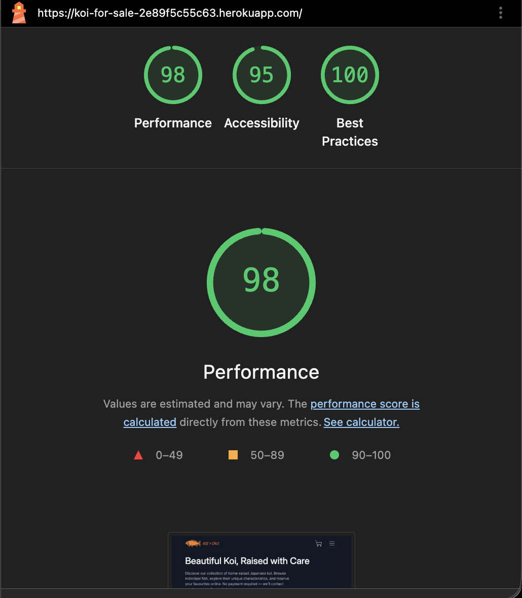
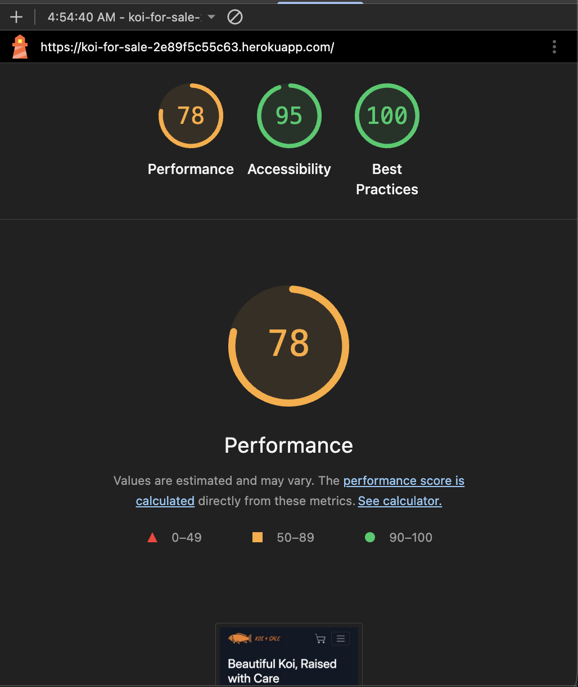
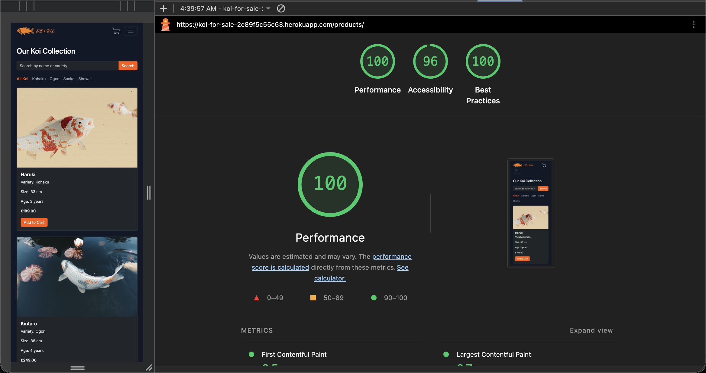
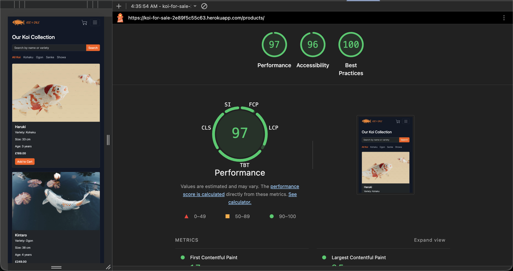
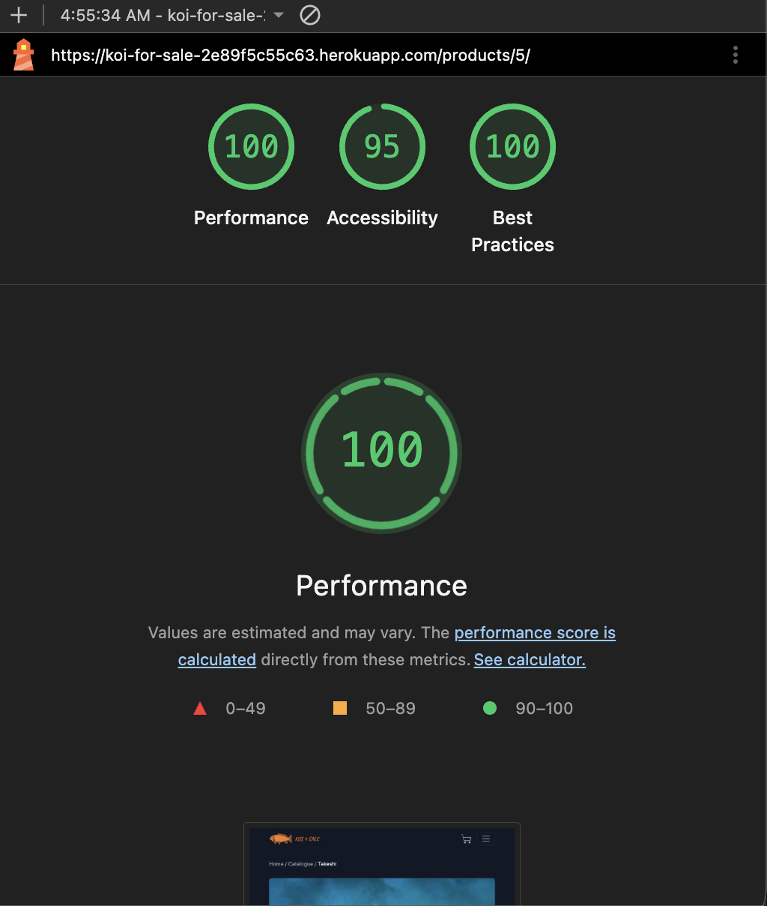
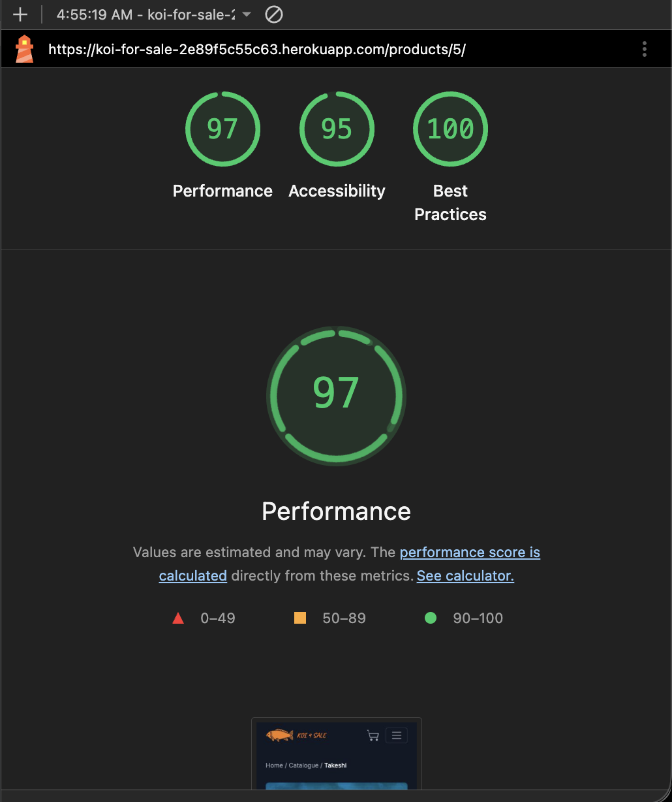

# Koi4Sale – Testing

## Overview

Koi4Sale was tested using Django's built-in test framework, Jest and manual checks. Automated tests verify application logic, while manual checks assess user-facing behaviour and administration. The results below distinguish completed checks from those still awaiting verification.

## Automated Testing

### Django

Run the complete Django test suite:

```bash
python3 manage.py test
```

Latest result:

```text
Found 70 test(s).
System check identified no issues (0 silenced).
Ran 70 tests in 28.658s
OK
```

Django tests cover areas including product search, reservation form validation, reservation workflows, access permissions and page rendering.

### JavaScript

Install dependencies and run Jest:

```bash
npm install
npm test
```

Latest result:

```text
PASS tests/cart-ui.test.js
PASS tests/cart-page.test.js
PASS tests/cart.test.js

Test Suites: 3 passed, 3 total
Tests:       19 passed, 19 total
Snapshots:   0 total
```

### Results

| Test suite | Passed | Failed | Result   |
| ---------- | -----: | -----: | -------- |
| Django     |     70 |      0 | PASS     |
| Jest       |     19 |      0 | PASS     |
| **Total**  | **89** |  **0** | **PASS** |

## User Story Testing

The table summarises verification of the 14 implemented user stories. Automated results are supported by the passing test suites above. `PENDING` identifies manual checks not yet recorded as completed. Screenshots of implemented features are provided in the main README's Features section.

| User Story                     | Verification                                                                                                        | Result                              |
| ------------------------------ | ------------------------------------------------------------------------------------------------------------------- | ----------------------------------- |
| Browse Available Koi           | Check catalogue displays available products and excludes reserved products.                                         | PASS manual check                   |
| View Koi Details               | Check product information, images and add-to-cart action.                                                           | PASS manual check                   |
| Filter Koi by Category         | Check category filtering and matching results.                                                                      | PASS manual check                   |
| Search Koi                     | Django search tests passed; manually check name, variety.                                                           | Automated PASS; manual PASS         |
| Responsive Catalogue           | Check product grid and images on mobile, tablet and desktop.                                                        | PASS                                |
| Manage Shopping Cart           | Jest cart tests passed; check add, remove, totals and persistence in a browser.                                     | Automated PASS; manual PASS         |
| Shopping Cart Indicator        | Check count updates and desktop/mobile visibility.                                                                  | Automated PASS; manual PASS         |
| Submit a Reservation Request   | Django validation/workflow tests passed; valid submission and correction of an invalid email were checked manually. | Automated PASS; partial manual PASS |
| Prevent Duplicate Reservations | Verify unavailable koi cannot be reserved again.                                                                    | Automated PASS; manual PASS         |
| Manage Products                | Create, view, update and delete products in Django Admin; check availability changes in catalogue.                  | Manual PASS                         |
| Manage Orders                  | Check order status updates and product availability after cancellation.                                             | PASS manual check                   |
| Responsive Navigation          | Check menu, links and cart access across screen sizes.                                                              | PASS                                |
| Delivery Information           | Check page content, four delivery steps and catalogue link.                                                         | PASS final check                    |
| Contact Information            | Check page, email links, active navigation and keyboard access.                                                     | Manual PASS (previously recorded)   |

The FAQ page, featured koi carousel and reservation confirmation email are deferred _Could Have_ features and are excluded from current-release testing.

### Additional Feature — Custom 404 Page

| Test         | Expected Result                  | Actual Result         | Status |
| ------------ | -------------------------------- | --------------------- | ------ |
| Invalid URL  | Custom 404 page is displayed     | Custom page displayed | PASS   |
| HTTP status  | Server returns HTTP 404          | HTTP 404 returned     | PASS   |
| Back to Home | Button redirects to the homepage | Homepage opened       | PASS   |

### Recorded Manual Checks

The following checks were already completed during development:

| Area             | Check                                                                          | Recorded result |
| ---------------- | ------------------------------------------------------------------------------ | --------------- |
| Django Admin     | View, create, update and delete a product.                                     | PASS            |
| Django Admin     | Mark a product reserved and confirm it disappears from the catalogue.          | PASS            |
| Django Admin     | Restore product availability and confirm it reappears.                         | PASS            |
| Reservation form | Invalid email displays an error.                                               | PASS            |
| Reservation form | Form values and cart contents remain after validation fails.                   | PASS            |
| Reservation form | Corrected email allows a successful reservation.                               | PASS            |
| Contact          | Page loads, links open email application, navigation and keyboard access work. | PASS            |

The following reservation form checks have **not** yet been recorded manually: empty required fields; letters in phone number; valid UK and international phone numbers; phone numbers shorter than 7 or longer than 15 digits; unsupported phone characters. Automated form-validation tests passed.

## Responsive Testing

Check the homepage, catalogue, product details, cart, reservation form, Delivery and Contact pages at mobile, tablet and desktop widths. Verify readable text, correctly sized images, usable navigation, accessible cart controls and no unintended horizontal scrolling.

| Device / viewport | Result |
| ----------------- | ------ |
| Mobile            | PASS   |
| Tablet            | PASS   |
| Desktop           | PASS   |

## Browser Compatibility

| Browser | Result |
| ------- | ------ |
| Chrome  | PASS   |
| Safari  | PASS   |
| Firefox | PASS   |

Chrome - Version 155.0.8059.82
Safari - Version 26.6.2
Firefox - 158.0

## Accessibility Testing

| Check                                                  | Result |
| ------------------------------------------------------ | ------ |
| Keyboard navigation and visible focus across all pages | PASS   |
| Form labels and validation messages                    | PASS   |
| Image alternative text                                 | PASS   |
| Heading hierarchy and semantic HTML                    | PASS   |
| Colour contrast                                        | PASS   |

## Code Validation

| Tool / check                                                  | Result  | Evidence                                                 |
| ------------------------------------------------------------- | ------- | -------------------------------------------------------- |
| HTML validation                                               | PENDING | Add result or screenshot                                 |
| CSS validation                                                | PENDING | Add result or screenshot                                 |
| Python linting / style checks                                 | PENDING | Add command and result                                   |
| JavaScript linting / style checks                             | PENDING | Add command and result                                   |
| Django deployment checks (`python3 manage.py check --deploy`) | PENDING | Add result and explain any environment-specific warnings |

## Lighthouse Testing

Google Lighthouse was used to evaluate the deployed Koi4Sale website
for performance, accessibility and best practices.

Testing was conducted using Chrome DevTools Lighthouse in both
desktop and mobile modes.

### Desktop Results

| Page            | Performance | Accessibility | Best Practices |
| --------------- | ----------- | ------------- | -------------- |
| Home            | 98          | 95            | 100            |
| Catalogue       | 100         | 96            | 100            |
| Product Details | 100         | 95            | 100            |

### Mobile Results

| Page            | Performance | Accessibility | Best Practices |
| --------------- | ----------- | ------------- | -------------- |
| Home            | 78          | 95            | 100            |
| Catalogue       | 97          | 96            | 100            |
| Product Details | 97          | 95            | 100            |

### Lighthouse Screenshots

#### Home

**Desktop**



**Mobile**



#### Catalogue

**Desktop**



**Mobile**



#### Product Details

**Desktop**



**Mobile**



### Image Optimisation

Website images were optimised to improve loading performance.

- Product photographs were converted from PNG to WebP.
- Home and Delivery images were converted from JPEG to WebP.
- Documentation screenshots were compressed without loss of quality.
- Large documentation images and Lighthouse screenshots were converted
  to lossless WebP.

### Lighthouse Results Summary

All three pages achieved a Best Practices score of 100 on both
desktop and mobile devices.

Accessibility scores ranged from 95 to 96 across all tested pages.

Desktop Performance scores ranged from 98 to 100.

Mobile Performance scores ranged from 78 to 97. The Home page
received the lowest mobile Performance score (78), indicating
an opportunity for further optimisation.

## Bugs and Fixes

### Cart Button State Resets After Page Reload

**Status:** Fixed

**Related User Story:** Manage Shopping Cart

**Issue:**

After adding a koi to the shopping cart, the button displayed
"Added to Cart". However, refreshing the page reset the button
to "Add to Cart", even though the product remained in localStorage.

**Root Cause:**

The `initCartButtons()` function registered click event listeners
but did not restore button states from localStorage when the page loaded.

**Fix:**

Updated `initCartButtons()` to restore the correct button state
during initialisation.

**Testing:**

- Manually verified that products already in the cart display
  "Added to Cart" after refreshing the page.
- Added an automated regression test in `tests/cart-ui.test.js`
  to verify that button states are restored from localStorage.
- Confirmed that all 19 Jest tests and 71 Django tests pass.

**Final Status:** Fixed and verified by automated tests.

### Primary Product Image Selection in Django Admin

**Issue:** Selecting two primary images caused an `IntegrityError`
because the database allows only one primary image per product.

Changing the primary image also caused an error because Django Admin
attempted to assign the new primary image before clearing the previous one.

**Fix:**

- Added custom inline formset validation to prevent multiple primary images.
- Updated `ProductAdmin.save_formset()` to clear the previous primary image
  before saving the new selection.
- Retained the database constraint to protect data integrity.

**Testing:** Manually verified that selecting two primary images displays
a validation error and switching between primary images saves successfully.

**Status:** Resolved.

## Final Testing Summary

**Automated tests:** ???

**Manual testing:** ???
